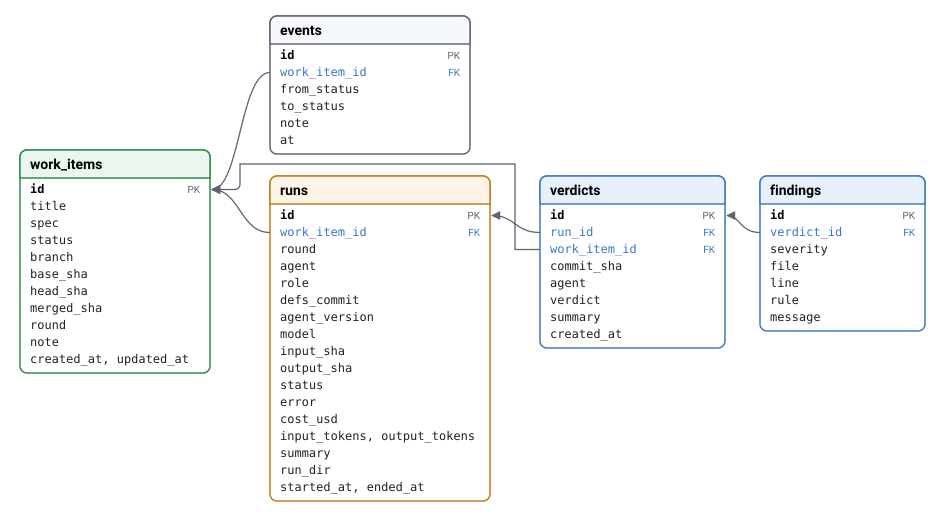

# Gauntlet in detail

The README describes what gauntlet is. This document shows how it works, using
the starting agent definitions and the record of a real queue: twelve items
run against a small Clojure calculator project in September 2026, on a Claude
plan. Costs are the API-equivalent estimates Claude Code reports.

- [The reviewers are an open set](#the-reviewers-are-an-open-set)
- [One agent in full: the comments reviewer](#one-agent-in-full-the-comments-reviewer)
- [How agents reference context files](#how-agents-reference-context-files)
- [What a rejection looks like, and how the worker gets it](#what-a-rejection-looks-like-and-how-the-worker-gets-it)
- [What is recorded: the database tables](#what-is-recorded-the-database-tables)
- [A real item: "simple UI", seven passes to merge](#a-real-item-simple-ui-seven-passes-to-merge)

## The reviewers are an open set

The orchestrator has no list of reviewers built in. It reads `agents.edn` from
the agent definitions repository and treats every entry with `:role :review`
as part of the gauntlet, run in ascending `:order`. Exactly one entry has
`:role :implement`; that is the worker. To change the gauntlet you change that
file and commit it:

- **Add a reviewer**: create `agents/<id>/prompt.md` (and any rule files it
  needs), add an entry with a unique `:order`, commit.
- **Remove one**: delete its entry.
- **Reorder**: change the `:order` numbers. They are spaced by 10 so a new one
  can go between two existing ones.
- **Change one**: edit its files. Only that agent's version changes, so
  approvals from the others are still valid.

`watch` reloads the definitions before each item, so a committed change
applies to the next item without a restart. The starting definitions have five
reviewers:

| Order | Agent | Checks | Model | Cap per run |
|---|---|---|---|---|
| — | worker | Implements the spec; follows house style | Sonnet | $2.00 |
| 10 | comments | Docstrings and comments | Haiku | $0.25 |
| 20 | language | Idiomatic use of the language, house style | Haiku | $0.25 |
| 30 | architecture | Layering, dependencies, structural rules | Sonnet | $0.75 |
| 40 | factoring | Duplication, function size, decomposition | Sonnet | $0.75 |
| 50 | test-coverage | Tests for the change, using real test and coverage reports | Sonnet | $0.75 |

A sixth would be another entry and another directory. For example, a reviewer
that checks the README stays in step with the code, placed between language
and architecture (this one does not exist; it shows the shape):

```clojure
 :docs
 {:role           :review
  :order          25
  :model          "claude-haiku-4-5-20251001"
  :max-budget-usd 0.25
  :context-paths  ["shared/review-protocol.md" "agents/docs"]}
```

The only thing every reviewer must share is the output format, which comes
from `shared/review-protocol.md`. Beyond that a reviewer can check anything
you can describe in prose: security rules, naming, migrations, accessibility,
performance budgets, licence headers.

## One agent in full: the comments reviewer

This is the complete definition of the first reviewer in the line. It is three
pieces.

`agents.edn` (its entry):

```clojure
 :comments
 {:role           :review
  :order          10
  :model          "claude-haiku-4-5-20251001"
  :max-budget-usd 0.25
  :context-paths  ["shared/review-protocol.md" "agents/comments"]}
```

`agents/comments/prompt.md`:

```markdown
# Comments reviewer

You check code comments and docstrings in the change against the guidelines
in `guidelines.md`.

In scope: comments, docstrings, and commented-out code added or modified by
the change. Also in scope: comments that the change has made inaccurate.

Out of scope: naming, structure, tests, and anything else not expressed in a
comment or docstring.
```

`agents/comments/guidelines.md`:

```markdown
# Comment guidelines

Replace or extend these with the project's own rules. Rule identifiers in
brackets are used in the `rule` field of findings.

- [C1] Public functions have a docstring that states what the function returns
  and any side effects. Blocking if missing.
- [C2] Comments explain why, not what. A comment that restates the code is
  advisory.
- [C3] A comment that no longer matches the code it describes is blocking.
- [C4] No commented-out code. Blocking.
- [C5] TODO comments must reference a work item or issue. Advisory.
```

The prompt is short on purpose. It says what the agent is responsible for and,
just as importantly, what it is not, so it does not wander into other
reviewers' concerns. The rules live in a separate file with identifiers
(`C1`…`C5`) that show up in findings, so a rejection can be traced to the exact
rule that caused it. The general rules about how to review, what is untrusted
and how to write a verdict come from the shared protocol file, not from this
directory.

## How agents reference context files

An agent's whole context is the list in `:context-paths`. Each entry is a path
in the agent definitions repository:

- A **file** path contributes that file. This is how agents share material:
  every reviewer lists `shared/review-protocol.md`, and both the worker and the
  language reviewer list `shared/house-style.md`, so the agent writing the code
  and the agent judging its style read the same rules.
- A **directory** path contributes every file in it, `prompt.md` first and the
  rest sorted by name. That is why the comments prompt can say "the guidelines
  in `guidelines.md`": the file is in its directory, so it is in its context.
  Adding a rules file to an agent is just dropping it into that directory.

The orchestrator concatenates the paths in order, wraps each in a
`<file path="…">` tag, and passes the result as the system prompt. It also
writes it to `system.md` in the run directory, so you can see exactly what an
agent was told. For the comments reviewer the file starts like this:

```
<file path="shared/review-protocol.md">
# Review protocol

You are one reviewer in a sequence of reviewers. Each reviewer checks one
concern. Review only the concern described in your own instructions; other
reviewers cover the rest.
…
</file>

<file path="agents/comments/prompt.md">
# Comments reviewer
…
</file>

<file path="agents/comments/guidelines.md">
# Comment guidelines
…
</file>
```

Context is read from the git object store at a pinned commit, not from the
working copy, and none of it is mounted into the container. The agent's
**version** is a SHA-256 over each context path and that path's git object
SHA. Editing `agents/comments/guidelines.md` changes only the comments
reviewer's version; editing `shared/review-protocol.md` changes every reviewer
that lists it.

Some context is not prose. An agent can also list `:inputs`, reports the
orchestrator produces by running ordinary commands in a separate checkout and
mounts at `/inputs`. The test-coverage reviewer asks for two:

```clojure
;; agents.edn
:inputs [:test-results :coverage-report]

;; gauntlet.edn (the project config says how to produce them)
:inputs {:test-results    {:cmd "clojure -M:test"}
         :coverage-report {:cmd "clojure -M:coverage"}}
```

## What a rejection looks like, and how the worker gets it

Here is one rejection from the item described in the last section, followed
from the reviewer's output to the worker's next attempt.

### 1. The reviewer writes a verdict file

Test-coverage reviewed commit `bc0df27` (run 60) and wrote
`/out/verdict.json`:

```json
{
  "verdict": "reject",
  "summary": "Tests pass and the new error-handling branches in result-text are well covered, but the public build-frame function (the actual UI construction) has zero test coverage, consistent with the 26% line coverage reported for calc.ui.",
  "findings": [
    {
      "severity": "blocking",
      "file": "src/calc/ui.clj",
      "line": 21,
      "rule": "T2",
      "message": "build-frame is a new public function with no test exercising it — the coverage report shows calc.ui at only 22.58% forms / 26.32% lines covered, indicating only result-text is tested. build-frame doesn't call setVisible, so it can be invoked in a headless test to assert on the returned JFrame's component tree (e.g. that the panel contains the expected fields/button, or that triggering the button's ActionListener updates the result label) without needing a display."
    }
  ]
}
```

The orchestrator checks the file before accepting it. The verdict must be
`reject` if and only if there is a blocking finding; anything else is invalid
output and sends the item to `needs_human`. The reviewer cited rule `T2` and
used the coverage numbers from `/inputs/coverage-report` rather than guessing.

### 2. The orchestrator records it

The run gets a row in `runs` (agent, model, agent version, definitions commit,
the commit it read, cost). The verdict gets a row in `verdicts` keyed by the
commit, and each finding a row in `findings`:

```
runs      id 60  agent test-coverage  model claude-sonnet-5  input_sha bc0df27…  cost $0.104
verdicts  id 47  run_id 60  commit_sha bc0df27…  verdict reject
findings  verdict_id 47  blocking  src/calc/ui.clj:21  T2  "build-frame is a new public function…"
```

Advisory findings are stored the same way. In the same round the factoring
reviewer approved with one advisory finding (the UI's operator list
duplicated the calculator's). It is in the database and shown by `bb show`,
but it is not sent to the worker.

### 3. The item goes back to the worker with a feedback file

Before the next worker run, `pipeline.clj` takes the latest rejection, keeps
only its blocking findings, and writes them to `/task/feedback.json`:

```clojure
(defn- feedback-for
  "Blocking findings from the latest rejection, for the worker's next round."
  [ds item]
  (when-let [v (db/latest-rejection ds (:id item))]
    {:reviewer   (:agent v)
     :commit     (:commit-sha v)
     :summary    (:summary v)
     :findings   (->> (:findings v)
                      (filter #(= "blocking" (:severity %)))
                      (mapv #(select-keys % [:file :line :rule :message])))}))
```

What worker run 61 actually received:

```json
{"reviewer":"test-coverage",
 "commit":"bc0df27a263313deb8733639734a6541164ec97a",
 "summary":"Tests pass and the new error-handling branches in result-text are well covered, but …",
 "findings":[{"file":"src/calc/ui.clj","line":21,"rule":"T2",
              "message":"build-frame is a new public function with no test exercising it — …"}]}
```

The worker's prompt says: "Address every blocking finding. Advisory findings
are optional." It has no other channel to the reviewer; this file and the spec
are all it gets.

### 4. The worker responds with a new commit and a summary

Run 61 committed `0b32041` and wrote this `/out/result.json`:

```json
{
  "status": "done",
  "summary": "Addressed the blocking reviewer finding (T2) that build-frame had zero test coverage. Real java.awt.Window/JFrame instantiation is impossible in this environment's headless-only JDK build […] so I extracted the actual UI construction and button-listener wiring into a new build-panel function that uses only lightweight Swing components […] Added test/calc/ui_test.clj build-panel-test […] calc.ui line coverage rose from 26% to 82%. Full test suite passes (14 tests, 31 assertions, 0 failures/errors)."
}
```

That summary is stored on the run and shown by `bb trace`. The new commit then
starts the gauntlet again from the first reviewer.

## What is recorded: the database tables

Everything above lives in five SQLite tables in `data/gauntlet.db`. Only the
orchestrator writes to them; agents never see the database.



Arrows go from a foreign key to the row it references. One work item has many
events and runs; a reviewer run has one verdict; a verdict has any number of
findings. A worker run has no verdict.

| Table | One row per | Used for |
|---|---|---|
| `work_items` | queued item | Title, spec, current status and round, and the commits that matter: the base it started from, the current head, and where it merged. |
| `events` | status change | The item's history, with notes such as "rejected by test-coverage after 3 rounds". `bb trace` uses it to place stops and requeues. |
| `runs` | agent execution | Who ran (agent, role, model, agent version, definitions commit), on which commit (`input_sha`), what it produced (`output_sha` for the worker), cost and tokens, the worker's summary, and the run directory with its `system.md` and output files. |
| `verdicts` | reviewer run | Approve or reject, and the summary, keyed by `commit_sha`. The reuse check ("has this reviewer at this version already approved this commit?") is a lookup here joined to `runs` for the version and model. |
| `findings` | finding in a verdict | Severity, file, line, rule and message. The blocking ones from the latest rejection become the worker's `feedback.json`. |

The `verdict` column also allows `override`, reserved for a human verdict that
TODO.md plans to add.

## A real item: "simple UI", seven passes to merge

Item 9 in the queue is the longest so far. The whole spec was one line:

```
add a very simple UI, that just uses the standard UI components available in the jvm
```

It was queued at 23:42 on 2026-09-26 and merged at 00:33, 51 minutes and about
$4.70 later. It went through seven worker runs and was rejected by two
different reviewers for three different reasons. Each row below is one pass
through the line.

| Pass | Worker commit | Reviewers | What happened |
|---|---|---|---|
| 1 | `7fb2693` | comments ✗ | C1: `-main` in the new `calc.ui` had no docstring. The next worker run crashed without committing, so the item went to `needs_human` ("worker made no commits") and was requeued by hand. |
| 2 | `bc0df27` | comments ✓ language ✓ architecture ✓ factoring ✓ test-coverage ✗ | Docstring fixed. Test-coverage rejected under T2: `build-frame` untested, `calc.ui` at 26% of lines (the example in the previous section). |
| 3 | `0b32041` | four ✓, test-coverage ✗ | Worker extracted `build-panel` so the UI could be tested without a display; coverage rose to 82%. Still rejected: `build-frame` itself had no test. |
| 4 | `863c609` | four ✓, test-coverage ✗ | Rejected again: `launch` and `-main` untested. This was the third round, so the item stopped: "rejected by test-coverage after 3 rounds". Requeued; on retry the four approvals of `863c609` were reused and only test-coverage ran again. It rejected again. |
| 5 | `e87de2c` | four ✓, test-coverage ✗ | Worker added tests, but they skipped themselves when there was no display. The reviewer noticed: the container is headless, so the tests ran nothing. |
| 6 | `bba5796` | comments ✗ | Worker introduced a `FrameBehavior` protocol so a fake frame could stand in for a real `JFrame` in tests. Comments then rejected it (C1): the protocol methods had no docstrings. Third round again; item stopped ("rejected by comments after 3 rounds"). |
| 7 | `bba5796` | all five ✓ ⇒ merged | Requeued. The comments reviewer ran again on the same commit and approved it this time. Test-coverage approved at 89% of lines with two advisory notes (real `JFrame` wiring cannot run headless; one test depends on component order). Main fast-forwarded to `bba5796`. |

> [!NOTE]
> **What this item shows.**
>
> The loop works: each rejection named a rule and a line, and each worker pass
> changed exactly that. The code that merged is better tested than the first
> attempt, and the design changed (a protocol for the frame) to make that
> possible.
>
> It also shows the weak spots. Test-coverage rejected four times over
> variations of one point, because a rerunning reviewer does not see what it
> said last time; giving it its previous findings is the second item on the
> TODO list. Swing code that needs a display does not fit rule T2 in a headless
> container, and needs a policy. And the comments reviewer gave opposite
> verdicts on the same commit at the same version, which is a reminder that a
> verdict is a model's judgment, not a deterministic check.

`bb trace 9` prints this history from the database. The `events` table holds
every status change with its note, so the two `needs_human` stops and the
requeues are on record alongside the runs and verdicts.
